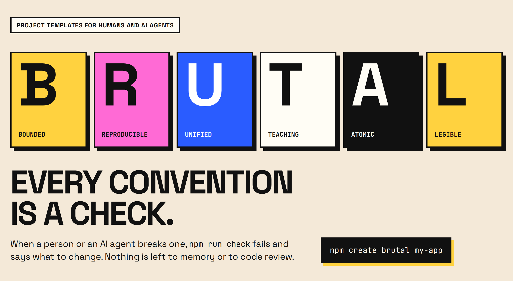

[](https://brutalway.elnop.dev/)

[](https://www.npmjs.com/package/create-brutal)
[](https://www.npmjs.com/org/brutalway)

# brutalway

Project templates where the conventions are enforced by deterministic checks. When several people or AI agents write in the same codebase, a convention that is only written down drifts within days. Here each one is a lint rule, an import rule or a tree rule, and `npm run check` fails with a message that says what to change.

```sh
npm create brutal my-app
```

The CLI asks for a stack, then for the parts to keep. Every combination passes `npm run check`. Each lint config, plugin and check is also published on its own under [`@brutalway`](https://www.npmjs.com/org/brutalway), for a project that did not start from a template: the [packages](packages/README.md) page lists them.

A lone hook put in `src/features/todo-stats/hooks/useTodoProgress.ts`:

```
src/features/todo-stats/hooks holds a single child: move it up one level and delete the folder
```

The same hook importing from another feature:

```
error no-cross-feature: src/features/todo-stats/useTodoProgress.ts → src/features/todo-list/useTodoList.ts
  A feature never imports another feature: move what they share down to
  shared-features/ (business code) or src/shared/ (no domain).
```

A text written straight in a component:

```
error i18next(no-literal-string): disallow literal string: <p className="todo-stats-chip">{progress}% done</p>
```

The same messages reach Claude Code: a hook runs the checks on each file the agent edits and sends the errors back to it.

## Templates

Every template builds the same todo list, so the stacks can be compared side by side. The front ends share one neo-brutalist look (thick black borders, flat pastel colors, hard shadows), and so does the Swagger UI of the API.

| Template | Stack | Status |
|---|---|---|
| [template-vite](templates/vite) | Vite, React, zustand, Vitest, Playwright | ready |
| [template-fastify](templates/fastify) | Fastify, Zod, node:sqlite, node:test, Swagger UI | ready |
| [template-package](templates/package) | a standalone npm package: tsdown, node:test, changesets | ready |
| template-next | Next.js | planned |
| template-react-native | React Native | planned |

## Proposing a change

Anyone can open an issue or a pull request. Each kind of issue has its form:

- [Bug](https://github.com/Elnop/brutalway/issues/new?template=bug.yml): a check fails on valid code, misses invalid code, or a tool crashes
- [Rule or convention](https://github.com/Elnop/brutalway/issues/new?template=rule.yml): a missing check, or a change to one that exists
- [Template](https://github.com/Elnop/brutalway/issues/new?template=template.yml): a new stack, or a change to the stack of a template

Before asking to drop a rule, read [why the rules exist](docs/concepts/intent.md). Any open issue on the [roadmap](https://brutalway.elnop.dev/#/docs/brutalway/roadmap) can be picked up. In a project created from a template, `AGENTS.md` tells the agents to offer you an issue or a pull request here when a check gets in their way, instead of turning it off. A pull request is welcome without an issue first, [CONTRIBUTING.md](CONTRIBUTING.md) explains how to build and check the repository.

## Documentation

- [Getting started](docs/getting-started.md): create a project, add a feature, and see what each check answers
- [Guides](docs/guides/README.md): add the checks to an existing project, set up the Claude Code hook
- [Common rules](docs/reference/rules.md): every rule, the tool that checks it and the message it prints
- [create-brutal](packages/tools/create-brutal/README.md): the options of the CLI and the flags to run it without questions
- [Packages](packages/README.md): the `@brutalway/*` lint configs, plugins and checks, usable without a template
- [Concepts](docs/concepts/README.md): why the conventions are checked by tools, and where the ideas come from

The docs are also on [brutalway.elnop.dev](https://brutalway.elnop.dev/).

## Claude Code plugin

In a project that has `@brutalway/agent-hook` installed, the `brutal-checks` plugin runs it after each `Edit` or `Write`, without editing `.claude/settings.json`. In other projects it does nothing.

```
/plugin install brutal-checks --marketplace Elnop/brutalway
```

## Contributing

The templates live in `templates/`, the packages in `packages/`. [CONTRIBUTING.md](CONTRIBUTING.md) explains how to build, check and release them.
