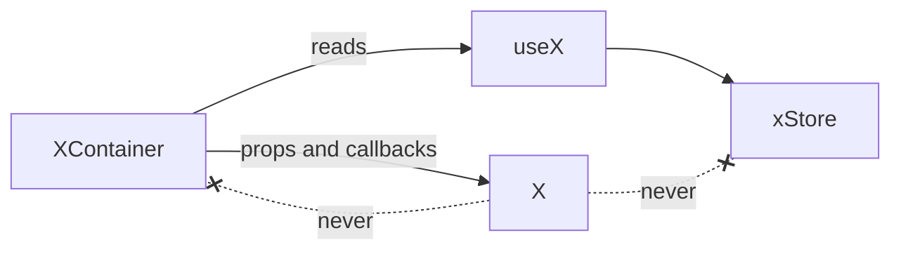

# Architecture

The intent behind every template of the series and the general principles they borrow from (Feature-Sliced Design, Screaming Architecture, fitness functions...) are in [the brutalway docs](https://github.com/Elnop/brutalway/tree/main/docs). This page covers what is specific to a React front end.

## Container and presentational components

From [Dan Abramov](https://medium.com/@dan_abramov/smart-and-dumb-components-7ca2f9a7c7d0) (2015): components that know where the data comes from are kept apart from components that only render what they are given.

We take the split, under other names. Orchestrators (`XContainer`, `XLayout`, `XPage`) read stores and pass data and callbacks down. Presenters, everything else, only get props.



We leave out higher-order components, which was how containers were written in 2015. Since 2019, Abramov's post says hooks make the split unnecessary. We keep it anyway: a presenter can be tested alone through its props, and an agent knows which components may touch state from the file name alone.

Enforced by `@brutalway/dependency-cruiser-config` (a presenter reaches no store through any chain of imports, and imports no orchestrator) and `@brutalway/oxlint-config-react` (no orchestrator in a `shared/`).

## Sub-features

From Feature-Sliced Design, extended. A feature can hold its own features in `features/<x>/features/<y>/`, with the same rules one level down: sub-features never import each other or their parent, and what they share goes into a slice of the parent's `shared/`, named after its concept.

```mermaid
flowchart TB
  parent["src/features/landing/"]
  subgraph subFeatures["landing/features/"]
    direction LR
    hero["hero/"] -. a sibling .-x grid["axiom-grid/"]
  end
  subgraph slices["landing/shared/"]
    axioms["axioms/"]
  end
  parent --> subFeatures
  subFeatures --> shared features
```

Enforced by `@brutalway/dependency-cruiser-config`.
